# EDA: what one year of 15-minute prices taught us

Source: [EDA_final.ipynb](../notebooks/EDA_final.ipynb), run on `data/train_prices_15min.csv` only (4 zones, 2025-10-01 → 2026-09-30, 363 days per zone, 139,392 quarter-hour prices, no missing values). No external data.
Figures: [results/eda_final/](../figures/eda_final/). Hours are clock hours (09h = 09:00–10:00).

**The story in one paragraph.** The four zones are four different markets in *level* and *risk*, but they share one *daily rhythm*: a morning peak, a deep solar valley at midday, and an expensive evening peak. The hourly price we are given already explains 93–96% of the price variance. The remaining 4–7%, the movement *inside* the hour, is what the challenge scores. That movement is not noise. Inside each hour the price slides in the direction the day's curve is moving, and it snaps back at the next hour, forming a **sawtooth**. The first and last quarters carry 2–3× more error than the middle two. The slide is predictable from the 24 hourly prices themselves: the slope between neighbouring hours correlates 0.76–0.91 with the tilt inside the hour. A one-parameter, no-training slope rule cuts the flat-baseline error by **40%**. What remains sits at the morning and evening ramps, the turning points and the day edges, and that is where the learned model has to earn its place.

---

## 1. Four zones, four markets

| | ZONE_0 | ZONE_1 | ZONE_2 | ZONE_3 |
|---|---:|---:|---:|---:|
| Mean | 104.4 | 119.8 | **138.3** | **76.8** |
| Median | 104.1 | 120.3 | 134.5 | 78.0 |
| Std | 63.1 | 60.6 | **42.6** | 61.1 |
| IQR (middle 50%) | 57.9 | 55.7 | 47.5 | **91.2** |
| Excess kurtosis | **9.9** | 8.4 | 1.5 | 3.2 |
| Min / Max | −500 / **747** | −499 / 645 | **0** / 350 | −499 / 487 |
| p1 / p99 | −15 / 271 | −9 / 280 | 13 / 260 | −12 / 230 |
| % negative quarters | 5.8 | 2.9 | **0.0** | **6.3** |

EUR/MWh, 15-minute prices.

- **ZONE_0 and ZONE_1 are spiky.** They have the full range from the −500 floor to 747 / 645, and very heavy tails: excess kurtosis of 8–10 means extremes happen far more often than in a bell curve.
- **ZONE_2 is expensive but calm.** It has the highest level, the lowest volatility, has never been negative, and peaks at only 350.
- **ZONE_3 is cheap and solar-driven.** It has the lowest level and the widest everyday range (IQR 91). A quarter of its prices are below 24, and 6.3% are negative.
- **The mean is close to the median in every zone,** so averages are a fair typical value, but they hide extremes in both directions.

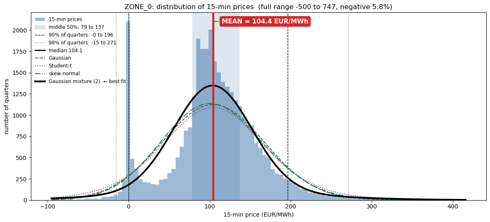

Other zones: [ZONE_1](../figures/eda_final/06_price_distribution_zone1.png) · [ZONE_2](../figures/eda_final/06_price_distribution_zone2.png) · [ZONE_3](../figures/eda_final/06_price_distribution_zone3.png)

- **A mixture of two Gaussians fits pooled raw prices best among the candidates by in-sample AIC.** This is descriptive, not evidence of two causal market regimes, a conditional error distribution, or the need for a two-model architecture. Price-only observations do not establish a solar mechanism.
- **For the model:** the official metric is MAE, which motivates L1 learning and median-oriented point predictions. Heavy tails motivate checking extreme errors separately; the distribution fit does not itself determine the training objective.

## 2. The typical day: two peaks and a solar valley

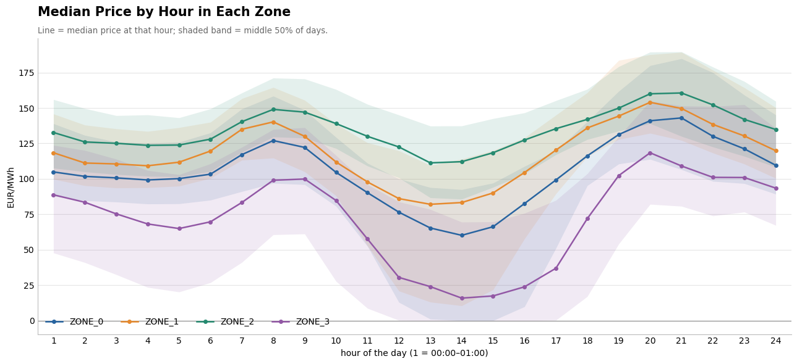

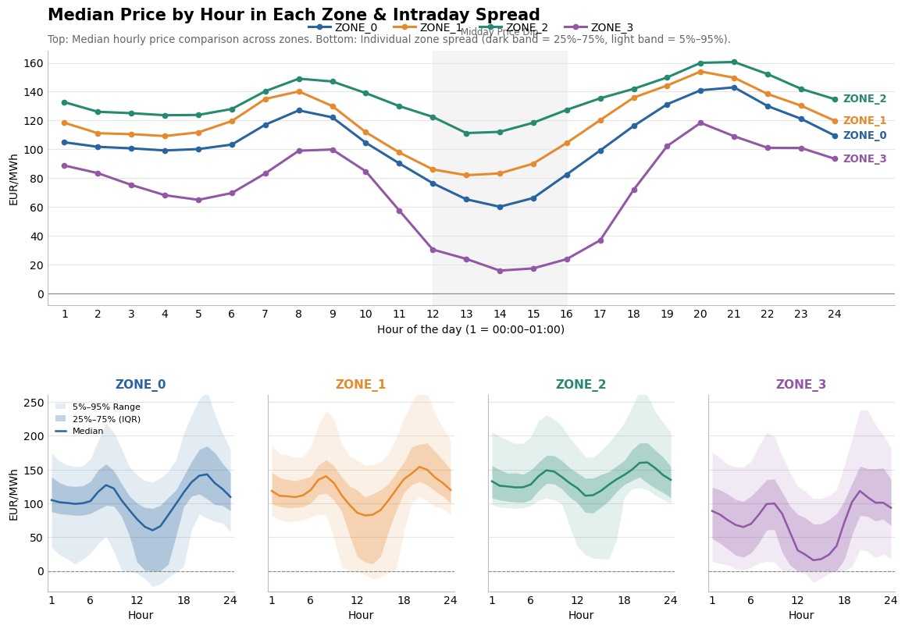

- **All zones share the same shape.** Prices are flat at night, peak in the morning (07–08h), reach a **midday minimum at 13h**, and climb to the **evening peak at 19–20h**, the most expensive time of day.
- **The depth of the valley is what differs.** ZONE_3 falls to about **16 EUR/MWh** at midday, ZONE_0 to about 60, while ZONE_2 barely dips (about 110).

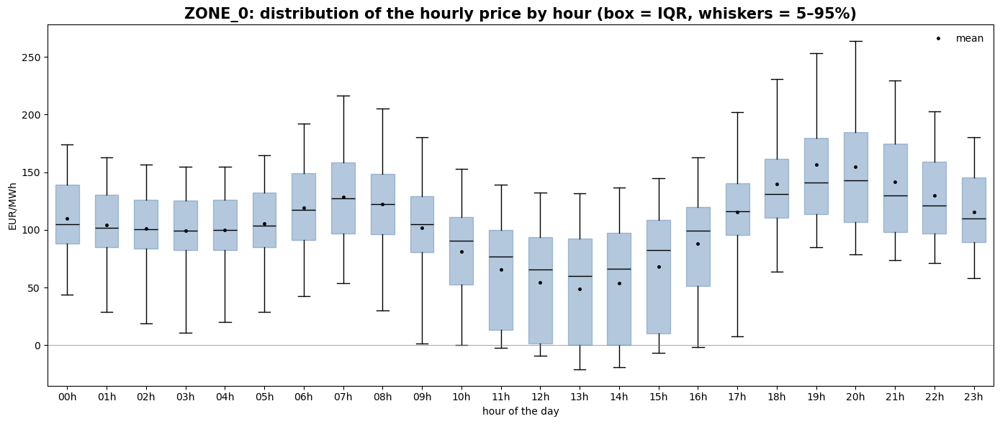

Other zones: [ZONE_1](../figures/eda_final/04_hour_boxplot_zone1.png) · [ZONE_2](../figures/eda_final/04_hour_boxplot_zone2.png) · [ZONE_3](../figures/eda_final/04_hour_boxplot_zone3.png)

- **Midday hours have the widest boxes,** reaching down to 0 or below. Night hours are narrow.
- **The skew flips during the day.** Midday hours have a long tail of *low* prices (skewness −2.2 in ZONE_0 at 14h, −3.1 in ZONE_3), while the evening has a long tail of *high* prices (+2.4 to +2.8 at 19h in ZONE_0/ZONE_1). Risk is downside at noon and upside in the evening.

## 3. The year day by day

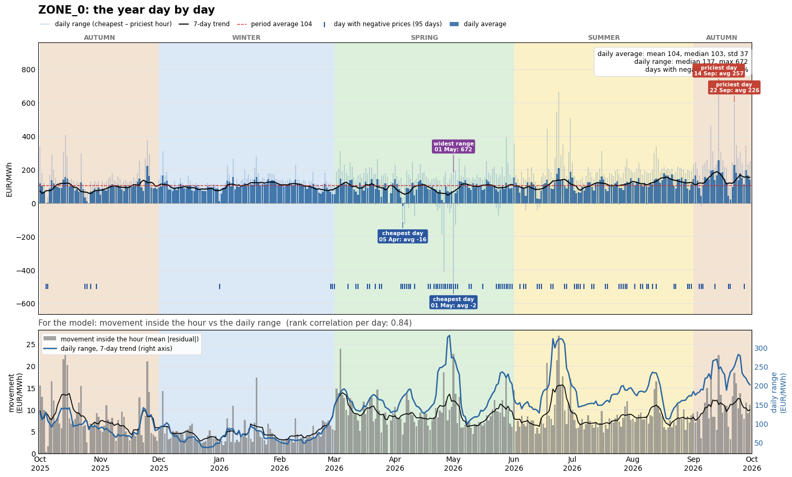

Other zones: [ZONE_1](../figures/eda_final/03_year_by_day_zone1.png) · [ZONE_2](../figures/eda_final/03_year_by_day_zone2.png) · [ZONE_3](../figures/eda_final/03_year_by_day_zone3.png)

The top panel shows the daily average, the daily low–high range, the 7-day trend and the days with negative prices. The bottom panel shows movement inside the hour against the daily range.

| Zone | Mean daily avg | Std daily avg | Median daily range | Days with negatives | corr(range, movement) | corr(level, movement) |
|---|---:|---:|---:|---:|---:|---:|
| ZONE_0 | 104 | 37 | 137 | 26% | **0.84** | 0.38 |
| ZONE_1 | 120 | 35 | 125 | 17% | **0.78** | 0.28 |
| ZONE_2 | 138 | 32 | 70 | 0% | **0.78** | 0.45 |
| ZONE_3 | 77 | 44 | 107 | 32% | **0.68** | 0.36 |

Correlations are Spearman rank correlations per day.

- **Winter is calm, and from March solar changes the market.** Movement inside the hour roughly doubles, and negative-price days arrive in clusters in spring and early summer.
- **Days with a wide range also move more inside the hour** (correlation 0.68–0.84). The price *level* matters much less (0.28–0.45). The day's spread is a feature we can compute from the 24 hourly prices.

## 4. What we see vs what is hidden

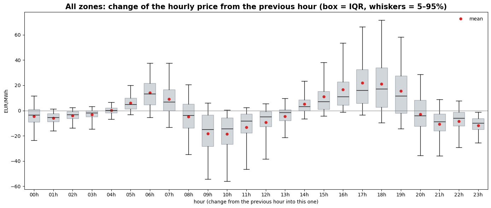

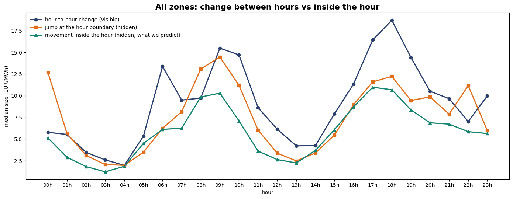

| All zones | Mean | Median | p95 |
|---|---:|---:|---:|
| Hour-to-hour change (visible in hourly data) | 12.8 | 7.7 | 42.3 |
| Jump at the hour boundary (hidden) | 11.0 | 6.4 | 36.7 |
| Movement inside the hour (hidden, what we predict) | 7.6 | 5.1 | 23.2 |

- **The ramps are where everything moves.** The price rises into 05–07h and 14–19h and falls into 08–12h and 20–02h. The hour-to-hour change is largest at 17–18h (up) and 09–10h (down).
- **The hidden movement follows the visible change.** All three lines peak at the morning ramp (09h) and the evening ramp (17–18h), and bottom out at 03–04h and 13h. This is the first sign that the hourly curve can predict the shape inside the hour.
- **Some hours break that link.** At 00h and 22h the boundary jump is large even though the hour-to-hour change is small. These are day-edge and night-transition effects that need extra features.

## 5. The residual: what we actually predict

Residual = 15-min price − hourly price. The 4 residuals of an hour always sum to 0.

| | ZONE_0 | ZONE_1 | ZONE_2 | ZONE_3 |
|---|---:|---:|---:|---:|
| Mean \|residual\| (= flat-guess MAE) | 7.91 | **9.43** | **5.59** | 7.38 |
| Std | 14.4 | 16.0 | 8.6 | 12.2 |
| p1 / p99 | −43 / +43 | −50 / +49 | −24 / +26 | −37 / +37 |
| Min / Max | −215 / +245 | −191 / +218 | −79 / +127 | −192 / +161 |
| Kurtosis | **24.2** | 13.6 | 7.6 | 13.3 |
| **% of price variance inside the hour** | 5.2 | 7.0 | 4.1 | 4.0 |

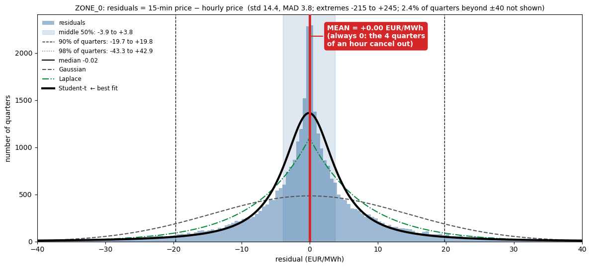

Other zones: [ZONE_1](../figures/eda_final/07_residual_distribution_zone1.png) · [ZONE_2](../figures/eda_final/07_residual_distribution_zone2.png) · [ZONE_3](../figures/eda_final/07_residual_distribution_zone3.png)

- **The hourly price already explains 93–96% of the variance.** The score is decided in the last 4–7%.
- **Residuals are sharply peaked with very fat tails.** Most quarters sit within ±4 EUR/MWh of their hour, but extremes reach ±200. **Student-t and Laplace fit far better than a Gaussian.** Laplace is the distribution behind the MAE loss, which supports choosing an L1 objective.
- **ZONE_1 is the hardest zone and ZONE_2 the easiest.** This ordering holds in every analysis that follows.

## 6. How far apart are the 4 quarters of an hour?

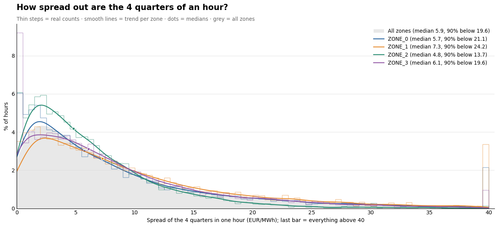

Fit per zone: [ZONE_0](../figures/eda_final/09_spread_fit_zone0.png) · [ZONE_1](../figures/eda_final/09_spread_fit_zone1.png) · [ZONE_2](../figures/eda_final/09_spread_fit_zone2.png) · [ZONE_3](../figures/eda_final/09_spread_fit_zone3.png)

- **Within-hour standard deviation:** its full-year median is **5.88 EUR/MWh** (ZONE_2 about 4.8, ZONE_1 about 7.3). This is not max-minus-min range, whose median is **15.14 EUR/MWh**.
- **There is a long tail in within-hour standard deviation:** about 1 hour in 10 exceeds **20 EUR/MWh**, and 1–3% exceed 40. These thresholds describe standard deviation, not range.
- **Some hours don't move at all:** 0.5–4.4% of hours, mostly in ZONE_3, have all 4 quarters at the same price.
- **Gamma and Weibull fit best and are almost tied** (KS gap about 0.01–0.03). Log-normal fits worst. There is no sign of separate regimes, just one smooth, skewed tail.
- **What this means:** the error will be driven by a minority of volatile hours. Each zone must be judged separately.

## 7. Extremes: rare, but always at the same times

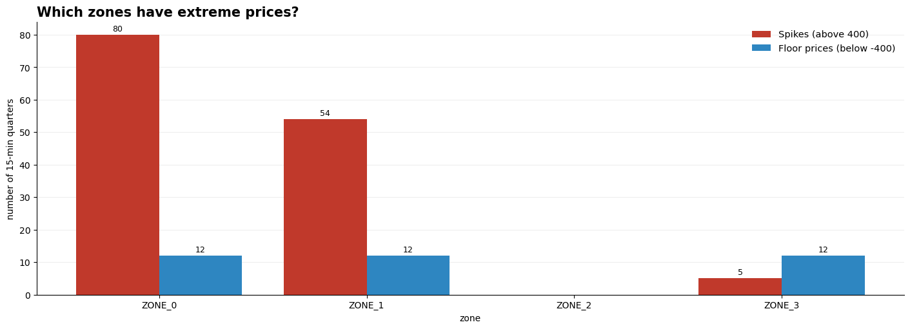

[By month](../figures/eda_final/10_extremes_by_month.png) · [By hour](../figures/eda_final/10_extremes_by_hour.png)

| | Spikes (> 400) | Floor (< −400) |
|---|---|---|
| Zones | ZONE_0 (80 quarters), ZONE_1 (54), ZONE_3 (5), ZONE_2 (0) | ZONE_0, ZONE_1, ZONE_3 (12 each) |
| When | **June (70)** and **September (42)**, e.g. 23–24 June and 14 Sep | Only **26 April** and **1 May 2026** |
| Hour | **Evening, 18–21h** (peak 19–20h) | **Midday, 12–14h** |
| Record | 747.10 (ZONE_0, 24 Jun 20:45) | −499.99 (ZONE_0, 1 May 13:15–13:45) |

- **Extremes hit several zones at once.** On 1 May, ZONE_0, ZONE_1 and ZONE_3 all sat at the floor for 8 quarters.
- **They follow the daily rhythm:** spikes at the evening peak, floors in the solar valley. Hour of day and zone are the key context for them.

## 8. Seasons: solar reshapes the day

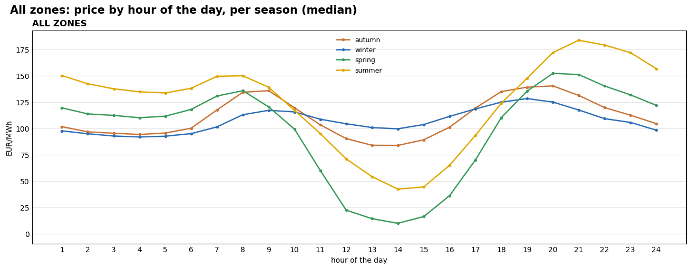

| All zones | Mean | Median | p5 | p95 | % negative | Cheapest hour | Priciest hour | Daily swing |
|---|---:|---:|---:|---:|---:|---:|---:|---:|
| Autumn | 119 | 108 | 11 | 237 | 1.5 | 13h | 19h | 56 |
| Winter | 104 | 104 | 23 | 166 | 0.5 | 03h | 18h | 37 |
| Spring | 93 | 111 | −0 | 173 | **7.6** | 13h | 19h | **142** |
| Summer | 122 | 135 | −0 | 205 | 5.3 | 13h | 20h | **141** |

- **Winter has a classic demand curve:** cheapest at night, with a small daily swing (37).
- **Spring and summer have a deep solar valley,** and their daily swing is almost **4× winter's**. Summer evenings are the most expensive hours of the year.

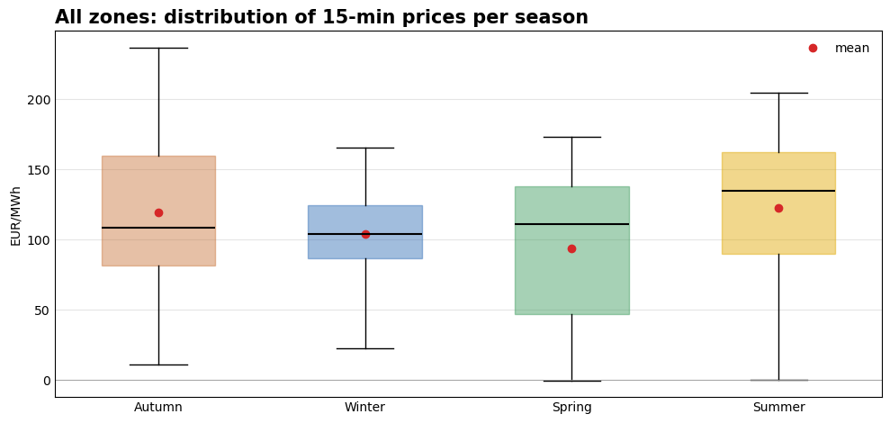

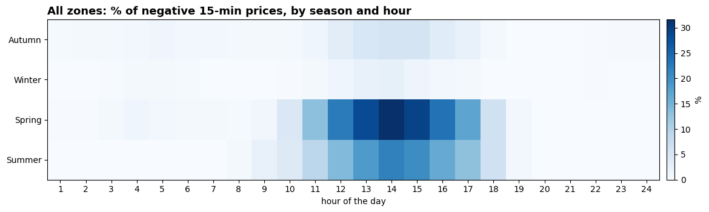

- **Negative prices are a spring and summer midday event.** In spring, about **30% of quarters at 13h are negative**. Outside 10–17h they barely exist.

**Movement inside the hour, by season**

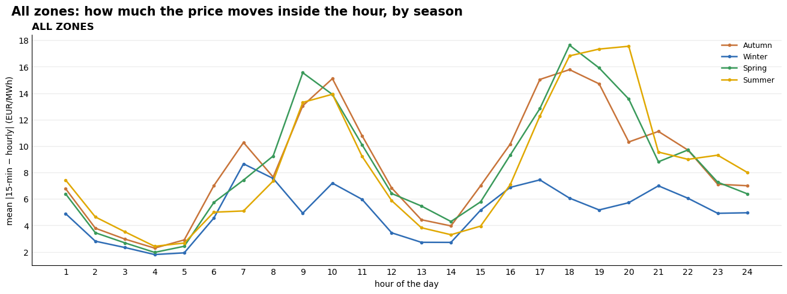

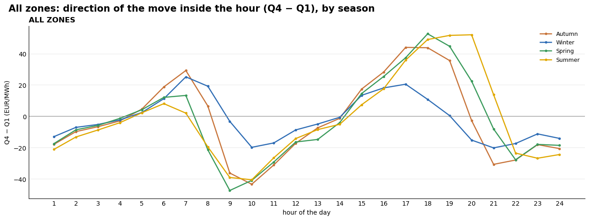

Zone by zone: [movement](../figures/eda_final/12c_move_by_season_zones.png) · [direction](../figures/eda_final/12d_direction_by_season_zones.png)

| All zones | Mean move | p90 move | Median swing | % hours with swing > 20 |
|---|---:|---:|---:|---:|
| Autumn | 8.6 | 19.0 | 17.7 | 45% |
| Winter | **5.0** | 10.4 | 10.8 | **24%** |
| Spring | 8.4 | 19.6 | 17.0 | 45% |
| Summer | 8.3 | 18.3 | 17.3 | 44% |

- **Winter moves about 40% less inside the hour.** The other three seasons are almost identical. This points to a simple winter-vs-solar-season regime, not four separate seasons.
- **The direction pattern is the same in every season** (falling in the morning, rising in the afternoon). Only its timing shifts: the evening climb ends around 18h in winter and around 20h in summer, following sunset.
- **Zone ordering holds in every season:** ZONE_1 moves the most (about 10–11 outside winter) and ZONE_2 the least (about 6).

## 9. The hourly price hides a lot

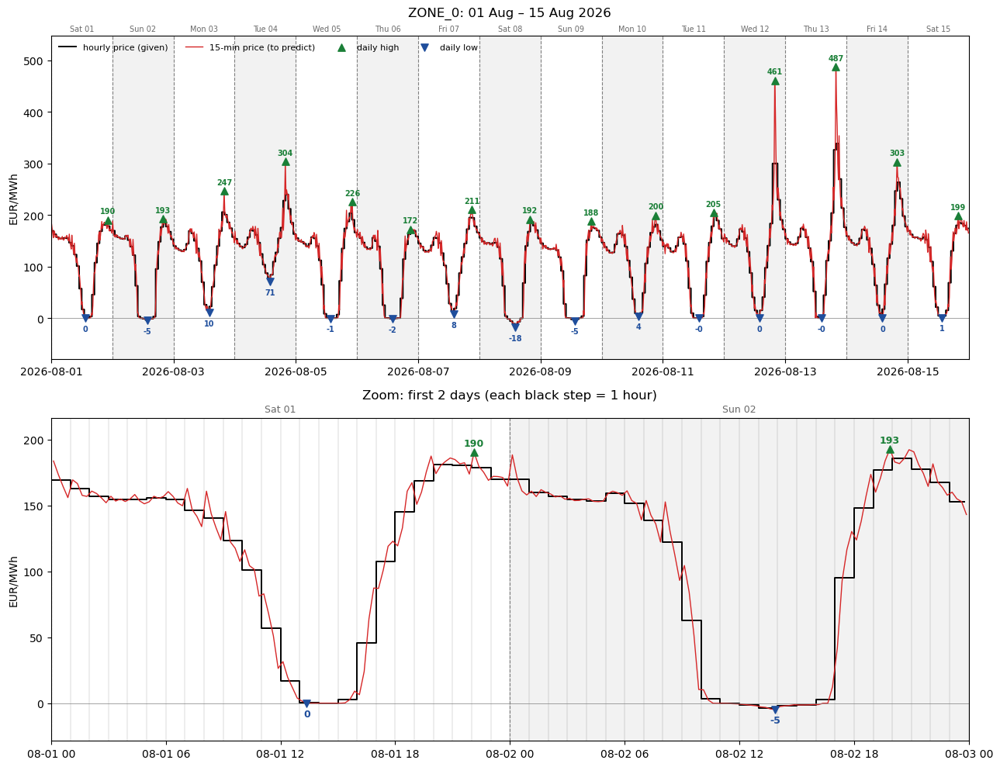

The black steps are what we're given and the red line is what we must reconstruct. Over 15 days in August (ZONE_0), every day dips to about 0 at midday and peaks in the evening, with spikes up to 487. The zoom shows the key detail: **the 15-minute price leads the hourly step.** It starts moving toward the next hour's level before the hour ends, and it undershoots or overshoots on steep ramps.

## 10. Prices slide toward the next hour

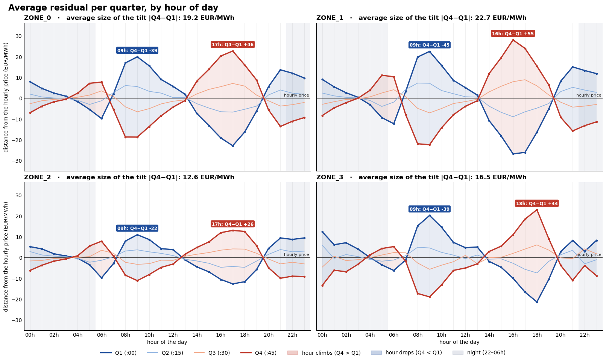

- **Every hour tilts in a straight line.** Q1 and Q4 are mirror images, and Q2 and Q3 move the same way at about ⅓ of the size.
- **The direction follows the day.** The price **drops** inside the hour at night (20–03h) and in the morning solar ramp (07–12h). It **climbs** in the early morning (04–06h) and the afternoon (13–19h).
- **Biggest drop at 09h** (Q4 − Q1 between −22 and −45). **Biggest climb at 16–18h** (between +26 and +55).
- **Turning points at about 03h, 07h, 13h and 20h:** the tilt flips sign there, and its direction varies from day to day.
- **Tilt size by zone:** ZONE_1 22.7, ZONE_0 19.2, ZONE_3 16.5, ZONE_2 12.6 EUR/MWh.

## 11. The sawtooth

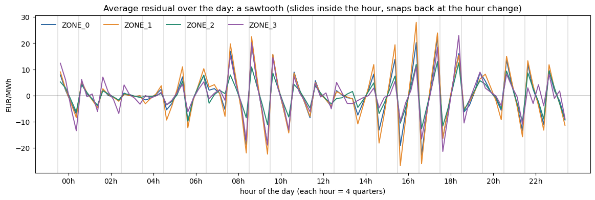

| Mean \|residual\| (flat-guess error) | Q1 | Q2 | Q3 | Q4 |
|---|---:|---:|---:|---:|
| ZONE_0 | **11.8** | 4.0 | 4.1 | **11.7** |
| ZONE_1 | **13.7** | 5.2 | 5.0 | **13.8** |
| ZONE_2 | **7.6** | 3.6 | 3.4 | **7.8** |
| ZONE_3 | **10.4** | 4.4 | 4.3 | **10.5** |

- **Slope, jump, slope, jump:** the price slides inside each hour and snaps back at every hour change. The biggest teeth are at 08–10h and 15–18h (up to ±25 EUR/MWh), and the pattern is almost flat at night (01–05h) and around noon (11–14h).
- **Q1 and Q4 carry 2–3× the error of Q2 and Q3.** Getting the edges right is most of the job.
- **The four zones move almost in lockstep.** One shape with a different strength per zone should work.

## 12. Day vs night

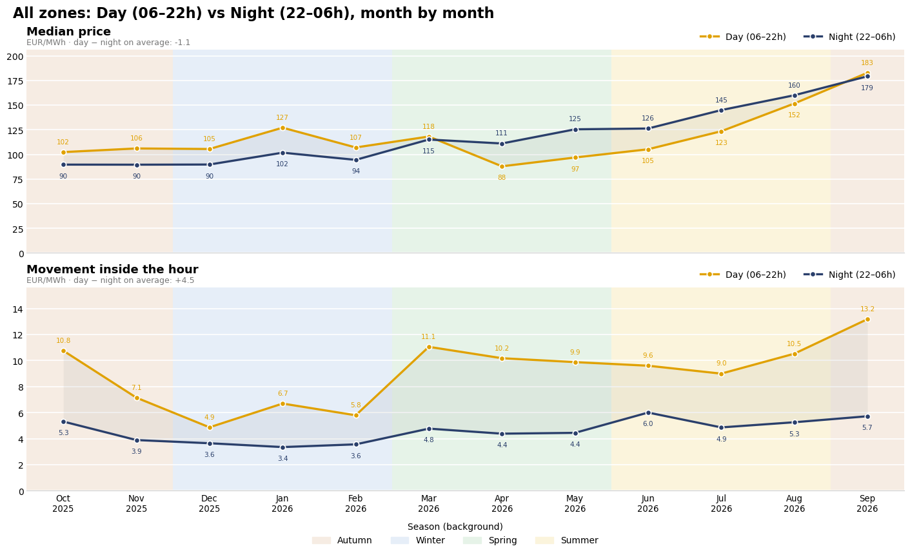

Per zone: [ZONE_0](../figures/eda_final/16_day_vs_night_month_zone0.png) · [ZONE_1](../figures/eda_final/16_day_vs_night_month_zone1.png) · [ZONE_2](../figures/eda_final/16_day_vs_night_month_zone2.png) · [ZONE_3](../figures/eda_final/16_day_vs_night_month_zone3.png)

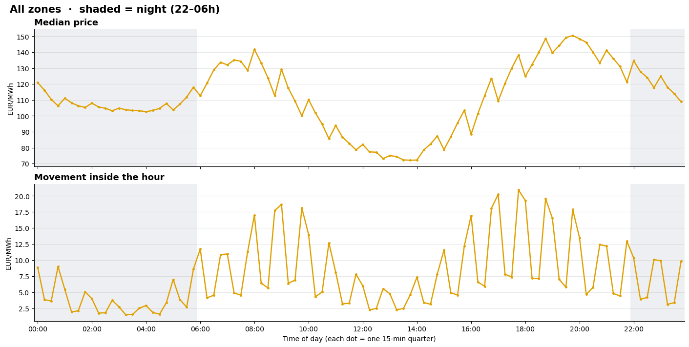

Per zone: [ZONE_0](../figures/eda_final/19_day_night_slots_zone0.png) · [ZONE_1](../figures/eda_final/19_day_night_slots_zone1.png) · [ZONE_2](../figures/eda_final/19_day_night_slots_zone2.png) · [ZONE_3](../figures/eda_final/19_day_night_slots_zone3.png)

- **Day and night prices swap places during the year.** From October to February the day (06–22h) is more expensive. From April to August solar makes the **night more expensive**, by up to 25 EUR/MWh. Over the year they almost cancel out (−1.1 EUR/MWh).
- **The day always moves more inside the hour,** about **2× the night**, in every month (+4.5 EUR/MWh on average). Night hours are close to flat. The interesting shape lives in daytime.

## 13. The slope between hours explains most of the shape

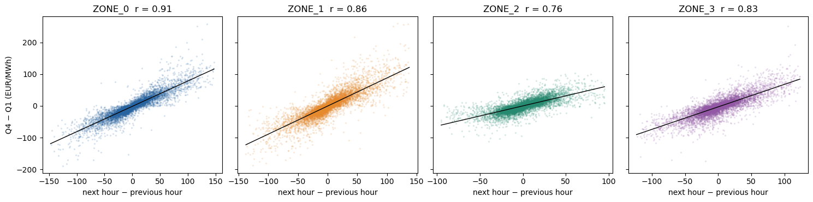

| | Pearson r | Spearman r | Fitted slope |
|---|---:|---:|---:|
| ZONE_0 | **0.91** | 0.93 | 0.80 |
| ZONE_1 | 0.86 | 0.89 | 0.89 |
| ZONE_2 | 0.76 | 0.80 | 0.64 |
| ZONE_3 | 0.83 | 0.83 | 0.71 |

Here the slope is next hour − previous hour, and the tilt is Q4 − Q1.

- **The slope between neighbouring hours predicts the tilt inside the hour,** and the rank correlation is just as high, so this is not driven by spikes.

**A rule with no training:** residual_q = k × slope_c × offset_q, with offsets (−0.375, −0.125, +0.125, +0.375) and slope_c = half the two-sided slope (one-sided at the day edges). The offsets sum to 0, so the hourly average is preserved automatically.

| MAE (EUR/MWh) | Flat | k = 1 | k = 1.5 | **k = 2** | k = 2.5 | k = 3 |
|---|---:|---:|---:|---:|---:|---:|
| ZONE_0 | 7.91 | 5.17 | 4.24 | **3.85** | 4.12 | 4.90 |
| ZONE_1 | 9.43 | 6.91 | 6.01 | 5.48 | **5.44** | 5.84 |
| ZONE_2 | 5.59 | 4.28 | **3.98** | **3.98** | 4.25 | 4.74 |
| ZONE_3 | 7.38 | 5.49 | 5.01 | **4.98** | 5.39 | 6.13 |
| **Mean** | **7.58** | 5.46 (−28%) | 4.81 | **4.57 (−40%)** | 4.80 | 5.40 |

- **One parameter removes 40% of the flat error,** and up to 51% in ZONE_0.
- **k ≈ 2 beats k = 1.** The price tilts about twice as much inside the hour as a straight line between hour centres would suggest, because most of the step to the next hour already happens *inside* the hour (the sawtooth).
- **The best k differs by zone** (2.5 for ZONE_1, about 1.5–2 for ZONE_2), so it should be set per zone.

*Descriptive only: k was chosen on the same data. In the pipeline it must be fitted on training folds and scored on later dates.*

## 14. Where the simple rule breaks

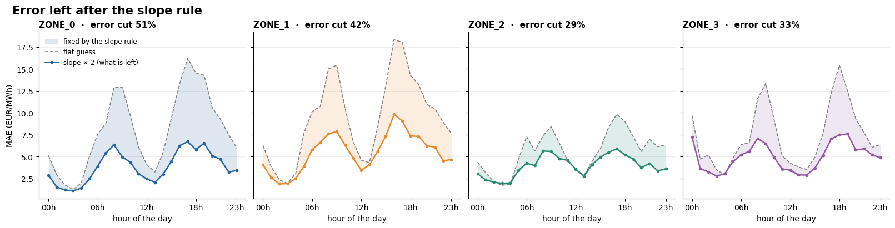

The dashed line is the flat guess, the solid line is slope × 2, and the shaded gap is what the rule fixes.

| Zone | Error cut by the slope rule |
|---|---:|
| ZONE_0 | 51% |
| ZONE_1 | 42% |
| ZONE_3 | 33% |
| ZONE_2 | 29% |

- **Nights are already solved.** The remaining error at 01–04h is about 1–2 EUR/MWh.
- **What's left sits at the ramps:** the morning (06–09h) and above all the evening (15–19h), where the error is still 6–10 EUR/MWh. These are the hours with the steepest, least regular moves and the spikes.
- **Day edges:** in ZONE_3 the error at 00h barely improves (about 9.7 → 7.2). At the first hour of the day the rule only has a one-sided slope, because the previous day is not inside the given curve.
- **ZONE_2 and ZONE_3 gain the least.** The slope correlation is weaker there, so they need more than the slope.

---

## What we take into the model

1. **Predict residuals, not prices.** The hourly level is given and explains 93–96% of the variance. Only the zero-sum shape inside the hour is learned, and a final re-centering guarantees the ±0.0001 constraint.
2. **Start from the slope.** A fixed slope ×2 baseline removes about 40% of full-sample flat error; cumulative PCHIP removes about 29%. They are different baselines. The multiplier was explored on the full sample, so chronological comparison remains exploratory.
3. **Add what the slope misses:** curvature and the ±2 neighbouring hours for the turning points (03h, 07h, 13h, 20h) and the peaks; hour of day; and the day's spread, which matters more than its level.
4. **Handle the day edges.** Use the previous day's history (for example, its last hours and recent residuals at the same hour) where the curve is one-sided.
5. **Work per zone and per regime.** Use a separate strength per zone (ZONE_1 strong, ZONE_2 weak) and a winter vs solar-season flag.
6. **Use a robust loss.** Fat-tailed, Laplace-like residuals and rare synchronized extremes call for **MAE / L1** objectives and median-based statistics.
7. **Validate on time only.** Fit k and models on earlier months, score on later ones, and take lag features strictly from earlier dates.

These findings are what the final AET pipeline builds on: PCHIP interpolation plus LightGBM on slope, curvature and zigzag coefficients, with an L1 loss and history features. It reaches **5.04 MAE vs 10.90 for flat** on the September 2026 backtest.

## Updated development comparison

On identical eight Jan–Aug development folds (days 19 onward):

| Method | MAE (EUR/MWh) |
|---|---:|
| Flat | 8.1276 |
| Linear ramp ×1 | 5.7580 |
| PCHIP | 5.6185 |
| Linear ramp ×2 | 4.8322 |
| Previous final model (I2) | 3.9479 |
| Current final model (I3) | 3.8883 |

The current final model improves 19.5% over slope ×2 (I2: 18.3%). Retain PCHIP as an intermediate comparison because it is the final model's baseline. Slope ×2 was suggested by full-year EDA; this is not a new untouched evaluation. Local-geometry and extrema-distance experiments are opt-in and do not change the saved model. No September targets are used in these experiments.
